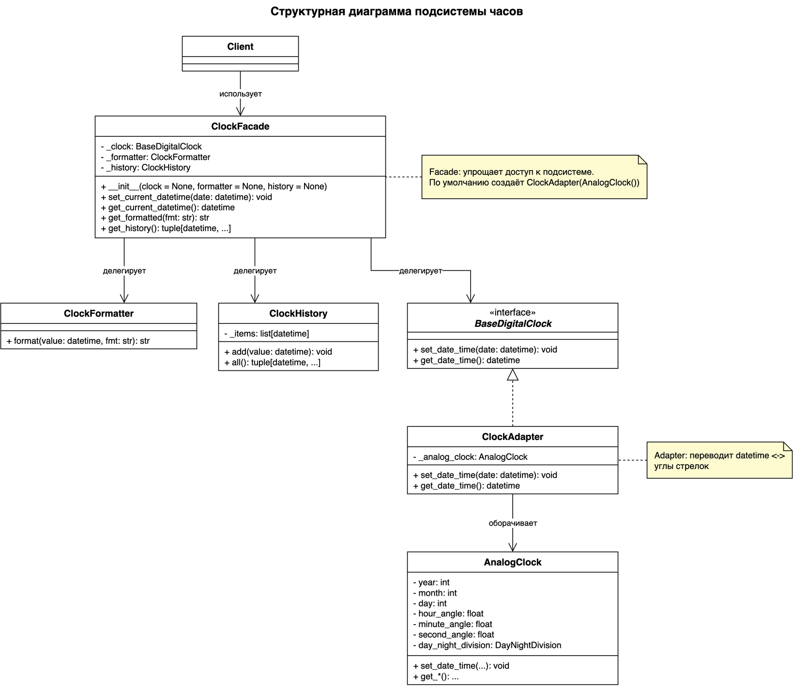

# Диаграмма

Структурная диаграмма (UML-диаграмма классов) итоговой реализации Adapter и Facade.

- [`structure_diagram.drawio`](structure_diagram.drawio) — исходник, открывается в [draw.io / diagrams.net](https://app.diagrams.net);
- [`structure_diagram.png`](structure_diagram.png) — изображение для просмотра (в него встроен исходник, поэтому PNG тоже можно открыть и редактировать в draw.io).

